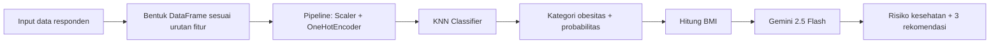

# 🩺 Obesity Classification — KNN + Gemini AI

[](https://obesity-classification-yp42tfpuzzbpf352cidgaa.streamlit.app)


Aplikasi web berbasis **Streamlit** untuk memperkirakan **tingkat obesitas** seseorang dari data fisik dan kebiasaan sehari-hari. Prediksi dilakukan oleh model **K-Nearest Neighbors (KNN)**, lalu hasilnya dianalisis oleh **Google Gemini** untuk memberikan gambaran risiko kesehatan dan rekomendasi gaya hidup dalam Bahasa Indonesia.

## 🚀 Coba Aplikasinya check

👉 **[obesity-classification-yp42tfpuzzbpf352cidgaa.streamlit.app](https://obesity-classification-yp42tfpuzzbpf352cidgaa.streamlit.app)**

Isi formulir data responden, klik **Prediksi Tingkat Obesitas**, dan lihat hasil klasifikasi beserta analisis dari Gemini AI.

> ⚠️ Aplikasi ini dibuat untuk **tujuan edukasi**, bukan alat diagnosis medis. Konsultasikan kondisi kesehatan Anda dengan dokter atau tenaga kesehatan.

## ✨ Fitur

- **Formulir input interaktif** untuk 16 atribut fisik dan kebiasaan responden.
- **Klasifikasi 7 tingkat obesitas** menggunakan pipeline preprocessing + KNN.
- **Probabilitas per kelas** yang bisa dibuka lewat expander.
- **Analisis Gemini AI** (`gemini-2.5-flash`): 2 poin risiko kesehatan utama dan 3 rekomendasi praktis berdasarkan hasil prediksi, BMI, dan kebiasaan pengguna.
- **Perhitungan BMI** otomatis dari tinggi dan berat badan sebagai konteks tambahan untuk analisis AI.

## 🏷️ Kelas Output

| Kelas | Keterangan |
|---|---|
| `Insufficient_Weight` | Berat badan kurang |
| `Normal_Weight` | Berat badan normal |
| `Overweight_Level_I` | Kelebihan berat badan tingkat I |
| `Overweight_Level_II` | Kelebihan berat badan tingkat II |
| `Obesity_Type_I` | Obesitas tipe I |
| `Obesity_Type_II` | Obesitas tipe II |
| `Obesity_Type_III` | Obesitas tipe III |

## 📋 Fitur Input

| Fitur | Deskripsi | Tipe |
|---|---|---|
| `Gender` | Jenis kelamin (Female / Male) | Kategorikal |
| `Age` | Usia (tahun) | Numerik |
| `Height` | Tinggi badan (meter) | Numerik |
| `Weight` | Berat badan (kg) | Numerik |
| `family_history_with_overweight` | Riwayat keluarga dengan kelebihan berat badan | Kategorikal |
| `FAVC` | Sering mengonsumsi makanan tinggi kalori | Kategorikal |
| `FCVC` | Frekuensi konsumsi sayur (1–3) | Numerik |
| `NCP` | Jumlah makan utama per hari (1–4) | Numerik |
| `CAEC` | Makan camilan di antara waktu makan | Kategorikal |
| `SMOKE` | Merokok | Kategorikal |
| `CH2O` | Asupan air harian (1–3 liter) | Numerik |
| `SCC` | Memantau asupan kalori harian | Kategorikal |
| `FAF` | Frekuensi aktivitas fisik (0–3) | Numerik |
| `TUE` | Waktu penggunaan perangkat teknologi (0–2) | Numerik |
| `CALC` | Konsumsi alkohol | Kategorikal |
| `MTRANS` | Moda transportasi utama | Kategorikal |

Atribut ini mengikuti dataset [Estimation of Obesity Levels Based on Eating Habits and Physical Condition](https://archive.ics.uci.edu/dataset/544/estimation+of+obesity+levels+based+on+eating+habits+and+physical+condition) dari UCI Machine Learning Repository.

## 🧠 Model

Model disimpan di `modelKNN_fixed-3.pkl` sebagai **scikit-learn Pipeline** yang sudah mencakup preprocessing, sehingga input mentah dari formulir bisa langsung diprediksi.

```
Pipeline
├── preprocess: ColumnTransformer
│   ├── num → StandardScaler   (Age, Height, Weight, FCVC, NCP, CH2O, FAF, TUE)
│   └── cat → OneHotEncoder    (Gender, family_history_with_overweight, FAVC,
│                               CAEC, SMOKE, SCC, CALC, MTRANS)
└── model: KNeighborsClassifier
        n_neighbors = 3
        metric      = manhattan
        weights     = distance
```

Model dilatih pada 1.965 sampel data latih menggunakan scikit-learn 1.6.1.

## 🔄 Alur Aplikasi



## 🛠️ Tech Stack

- **Python 3.11**
- **Streamlit** untuk antarmuka web
- **pandas** & **NumPy** untuk pengolahan data
- **scikit-learn 1.6.1** untuk pipeline dan model KNN
- **google-generativeai** untuk integrasi Gemini

## 📁 Struktur Repository

```
Obesity-Classification/
├── .devcontainer/          # Konfigurasi GitHub Codespaces / Dev Container
├── app.py                  # Aplikasi Streamlit (UI, prediksi, integrasi Gemini)
├── modelKNN_fixed-3.pkl    # Pipeline preprocessing + model KNN
├── requirements.txt        # Daftar dependensi
├── PRD.md                  # Product Requirements Document
└── README.md
```

## 💻 Menjalankan Secara Lokal

1. **Clone repository**

   ```bash
   git clone https://github.com/Herjuna3008/Obesity-Classification.git
   cd Obesity-Classification
   ```

2. **Install dependensi**

   ```bash
   pip install -r requirements.txt
   ```

3. **Siapkan API key Gemini** di `.streamlit/secrets.toml`

   ```toml
   API_KEY = "isi-api-key-gemini-anda"
   ```

   API key bisa dibuat di [Google AI Studio](https://aistudio.google.com/apikey). Jangan commit file ini ke repository.

4. **Jalankan aplikasi**

   ```bash
   streamlit run app.py
   ```

   Aplikasi akan terbuka di `http://localhost:8501`.

Repository ini juga sudah dilengkapi `.devcontainer`, jadi bisa langsung dibuka di **GitHub Codespaces**; dependensi akan terpasang dan aplikasi berjalan otomatis.

## ⚠️ Catatan

- Hasil prediksi bergantung pada model yang dilatih; aplikasi ini tidak melalui validasi klinis.
- Analisis Gemini dihasilkan oleh AI dan bisa keliru.
- Data yang dikirim ke Gemini: hasil prediksi, BMI, usia, gender, aktivitas fisik, konsumsi sayur, asupan air, kebiasaan merokok, dan riwayat keluarga.

## 👥 Kontributor

- [Herjuna3008](https://github.com/Herjuna3008)
- [kamzZ110](https://github.com/kamzZ110)
